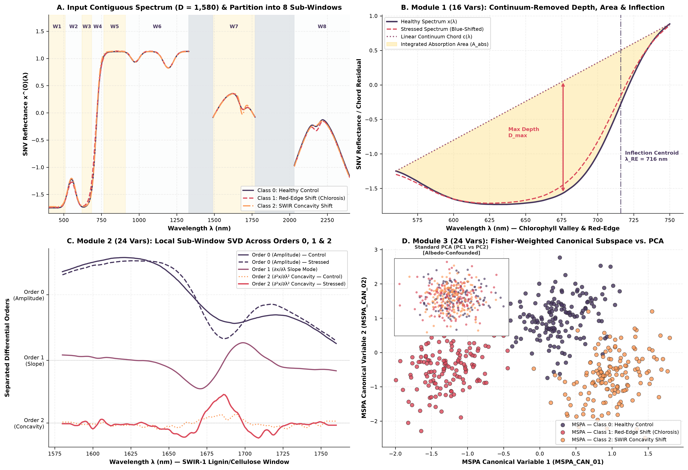

# MSPA: Morpho-Spectral Projection Analysis

[](https://colab.research.google.com/github/Lucas-Osco/mspa/blob/main/MSPA_Colab_Tutorial.ipynb)
[](https://opensource.org/licenses/MIT)
[](https://www.python.org/downloads/)
[](https://scikit-learn.org/)

**Morpho-Spectral Projection Analysis (`MSPA`)** is a supervised dimensionality reduction operator designed for contiguous one-dimensional reflectance, transmittance, and absorbance spectra ($\mathcal{T}: \mathbb{R}^D \to \mathbb{R}^K$).

Conventional dimensionality reduction methods—such as Principal Component Analysis (`PCA`), Partial Least Squares (`PLS-DA`), `UMAP`, and Self-Organizing Maps (`SOM`)—are **column-permutation invariant**: they treat adjacent wavelengths as unordered tabular columns, discarding the sequential differential geometry of the spectral curve. `MSPA` preserves physical wavelength contiguity while adhering strictly to the `scikit-learn` transformer API (`fit`, `transform`, `fit_transform`, `Pipeline`, and `set_output`).

<p align="center">
  
</p>

---

## Interactive Google Colab Demo

Test `MSPA` directly in your browser without installing anything locally using our interactive notebook with synthetic foliar reflectance spectra:

[](https://colab.research.google.com/github/Lucas-Osco/mspa/blob/main/MSPA_Colab_Tutorial.ipynb) **[Launch `MSPA_Colab_Tutorial.ipynb` in Google Colab](https://colab.research.google.com/github/Lucas-Osco/mspa/blob/main/MSPA_Colab_Tutorial.ipynb)**

---

## Why Standard Reducers Fail on Spectra: The Column-Permutation Problem

Let $`\mathbf{X} \in \mathbb{R}^{N \times D}`$ be a spectral matrix ordered along physical wavelengths $`\lambda_1 < \lambda_2 < \dots < \lambda_D`$, and let $`\mathbf{\Pi} \in \{0, 1\}^{D \times D}`$ be an arbitrary permutation matrix that randomly shuffles the order of the wavelengths ($`\mathbf{X}_{\mathbf{\Pi}} = \mathbf{X}\mathbf{\Pi}`$).

In standard `PCA`, the sample covariance matrix of the shuffled spectrum is $`\mathbf{\Sigma}_{\mathbf{\Pi}} = \mathbf{\Pi}^\top \mathbf{\Sigma} \mathbf{\Pi}`$, which simply permutes the rows of the eigenvectors ($`\mathbf{V}_{\mathbf{\Pi}} = \mathbf{\Pi}^\top \mathbf{V}`$). Consequently, the projected scores remain **numerically identical**:

$$\mathbf{Z}_{\text{PCA}}(\mathbf{X}\mathbf{\Pi}) = (\mathbf{X}\mathbf{\Pi})(\mathbf{\Pi}^\top \mathbf{V}_K) = \mathbf{X}(\mathbf{\Pi}\mathbf{\Pi}^\top)\mathbf{V}_K = \mathbf{Z}_{\text{PCA}}(\mathbf{X})$$

The exact same invariance holds for `PLS-DA` (via inner products $`\mathbf{X}^\top \mathbf{Y}`$), `UMAP`, and `SOM` (via pairwise Euclidean distances $`\Vert{}\mathbf{x}_i \mathbf{\Pi} - \mathbf{x}_l \mathbf{\Pi}\Vert{}_2 = \Vert{}\mathbf{x}_i - \mathbf{x}_l\Vert{}_2`$). Because these methods are blind to wavelength adjacency, high-variance non-diagnostic plateaus (such as leaf albedo in the Near-Infrared plateau) dominate the projection and mask narrow diagnostic absorption features.

You can verify this directly in Python:

```python
import numpy as np
from sklearn.decomposition import PCA
from mspa import MSPA, generate_synthetic_vegetation_spectra

X_df, y, wavelengths = generate_synthetic_vegetation_spectra(n_samples=450, random_state=42)
X_orig = X_df.to_numpy()
X_shuffled = X_orig[:, np.random.default_rng(777).permutation(X_orig.shape[1])]

# PCA is completely blind to wavelength order (Difference = 0.00e+00)
z_pca_1 = PCA(n_components=10, random_state=42).fit_transform(X_orig)
z_pca_2 = PCA(n_components=10, random_state=42).fit_transform(X_shuffled)
print("Max PCA difference after shuffling wavelengths :", np.max(np.abs(z_pca_1 - z_pca_2)))

# MSPA explicitly depends on contiguous curve topology (Difference = ~0.87)
z_mspa_1 = MSPA(n_components=64, wavelengths=wavelengths).fit_transform(X_orig, y)
z_mspa_2 = MSPA(n_components=64, wavelengths=wavelengths).fit_transform(X_shuffled, y)
print("Mean MSPA difference after shuffling wavelengths:", np.mean(np.abs(z_mspa_1 - z_mspa_2)))
```

---

## Mathematical Formulation: Inside the Three Modules of `MSPA`

First, `MSPA` automatically detects any excised atmospheric water-vapor gaps in $`\boldsymbol{\lambda}`$ (where $`\lambda_{j+1} - \lambda_j > 5 \cdot \text{median}(\Delta\lambda)`$) to partition the spectrum into contiguous blocks $`\mathcal{S}_1, \dots, \mathcal{S}_B`$. Within each contiguous block $`\mathcal{S}_b`$, analytical local least-squares Savitzky–Golay convolution estimates the **1st derivative** ($`\mathbf{X}^{(1)} \approx \partial \mathbf{X} / \partial \lambda`$, local slope) and **2nd derivative** ($`\mathbf{X}^{(2)} \approx \partial^2 \mathbf{X} / \partial \lambda^2`$, local concavity) without crossing gap boundaries.

The input spectrum $`\mathbf{x}_i \in \mathbb{R}^D`$ is then projected into $`\mathbf{z}_i = [\mathbf{z}_{i,\text{can}}^\top, \mathbf{z}_{i,\text{win}}^\top, \mathbf{z}_{i,\text{bio}}^\top]^\top \in \mathbb{R}^K`$ across three complementary modules:

### 1. Module 1 — Additive Continuum-Removed Geometry & Inflection Kinematics (`MSPA_BIO_*`, 16 vars)

In reflectance spectroscopy, biochemical absorption features appear as local concave valleys bounded by scattering shoulders. Across each absorption valley $`\mathcal{V}_v = [\lambda_{v,\text{start}}, \lambda_{v,\text{end}}]`$ ($`L_v`$ bands), `MSPA` constructs the linear continuum chord $`c_{i,v}(\lambda_j)`$ connecting the valley shoulders ($`t_j \in [0, 1]`$):

$$
c_{i,v}(\lambda_j) = x_i(\lambda_{v,\text{start}})(1 - t_j) + x_i(\lambda_{v,\text{end}})t_j, \qquad d_{i,v}(\lambda_j) = c_{i,v}(\lambda_j) - x_i(\lambda_j)
$$

When spectra are standardized via Standard Normal Variate ($`x_{i,j} = [r_{i,j} - \mu_i]/\sigma_i`$), the additive residual $`d_{i,v}(\lambda_j)`$ cancels out baseline brightness ($`\mu_i`$) and normalizes the band depth by the global radiometric contrast ($`\sigma_i`$) while avoiding division-by-zero singularities where $`c_{i,v}(\lambda_j) \approx 0`$. From each valley $`v`$, Module 1 extracts the **maximum contrast depth** ($`D_{\max, i, v}`$) and **integrated absorption area** ($`A_{\text{abs}, i, v}`$), alongside the **Red-Edge inflection wavelength centroid** ($`\lambda_{\text{RE}, i}`$):

$$
D_{\max, i, v} = \max_{\lambda_j \in \mathcal{V}_v} d_{i,v}(\lambda_j), \qquad A_{\text{abs}, i, v} = \frac{1}{L_v} \sum_{\lambda_j \in \mathcal{V}_v} d_{i,v}(\lambda_j), \qquad \lambda_{\text{RE}, i} = \frac{\sum_{\lambda_j \in \mathcal{W}_{\text{RE}}} \max(x_{i,j}^{(1)}, 0) \lambda_j}{\sum_{\lambda_j \in \mathcal{W}_{\text{RE}}} \max(x_{i,j}^{(1)}, 0) + \epsilon}
$$

Because $`\max(\cdot)`$ and horizontal wavelength shifts ($`\lambda_{\text{RE}}`$) are **nonlinear functionals**, Module 1 captures absorption band shifts (e.g., chlorotic blue-shifts) that cannot be represented by purely linear matrix projections.

### 2. Module 2 — Local Multi-Order Sub-Window Eigenmodes (`MSPA_WIN_*`, 24 vars)

To prevent high-variance spectral plateaus from masking subtle variations in narrower regions, Module 2 partitions the spectrum into $`W = 8`$ contiguous optical sub-windows $`\mathcal{W}_1, \dots, \mathcal{W}_8`$ (or uniform sub-windows when operating outside $`380\text{--}2500\text{ nm}`$). Within each window $`w`$ and for each differential order $`m \in \{0, 1, 2\}`$ independently, the standardized sub-matrix $`\tilde{\mathbf{X}}_{\text{train}, w}^{(m)}`$ is decomposed via Singular Value Decomposition (SVD) to project each sample onto the dominant rank-1 right singular vector $`\mathbf{v}_{w,1}^{(m)}`$:

$$
z_{i,\text{win}}^{(w, m)} = \left(\tilde{\mathbf{x}}_{i, w}^{(m)}\right)^\top \mathbf{v}_{w, 1}^{(m)}, \qquad w \in \{1, \dots, 8\}, \quad m \in \{0, 1, 2\}
$$

This guarantees that every spectral region contributes its primary mode of **amplitude** ($`m=0`$), **slope** ($`m=1`$), and **concavity** ($`m=2`$) ($`8 \times 3 = 24`$ variables).

### 3. Module 3 — Global Fisher-Weighted Shrinkage Canonical Subspace (`MSPA_CAN_*`, 24 vars)

To capture global cross-wavelength interactions where signatures diverge across classes $`c \in \{1, \dots, C\}`$, Module 3 concatenates the full state space $`\mathbf{M}_i = [\mathbf{x}_i^{(0)\top}, \mathbf{x}_i^{(1)\top}, \mathbf{x}_i^{(2)\top}]^\top \in \mathbb{R}^{3D}`$ and weights each channel $`q \in \{1, \dots, 3D\}`$ by its inter-class to intra-class Fisher discriminability ratio $`\omega_q`$:

$$
\tilde{\omega}_q = \sqrt{\frac{\text{Std}_{c}(\mu_{c,q})}{\frac{1}{C}\sum_{c=1}^{C} \sigma_{c,q} + \delta}}, \qquad \mathbf{H} = \tilde{\mathbf{M}} \, \text{diag}(\omega_1, \dots, \omega_{3D})
$$

After orthogonal SVD compression of $`\mathbf{H}`$ into $`\mathbf{U}`$, canonical discriminant directions $`\mathbf{w}`$ are extracted via analytical Ledoit–Wolf covariance shrinkage ($`\gamma = 0.35`$):

$$
\mathbf{\Sigma}_W^{(\gamma)} = (1 - \gamma)\mathbf{S}_W + \gamma \frac{\text{Tr}(\mathbf{S}_W)}{P}\mathbf{I}_P, \qquad \mathbf{\Sigma}_B \mathbf{w} = \Lambda \mathbf{\Sigma}_W^{(\gamma)} \mathbf{w}
$$

When $`C - 1 < K_{\text{can}}`$ (e.g., binary classification $`C=2`$ where $`\text{rank}(\mathbf{\Sigma}_B) = 1`$), `MSPA` extracts regularized discriminant axes separately for Orders $`0, 1, 2`$, and $`\mathbf{H}`$, and completes the remaining axes using singular-value-scaled orthogonal vectors of $`\mathbf{H}`$, preventing rank-1 noise overfitting.

---

## Installation

Install directly from GitHub via `pip`:

```bash
pip install git+[https://github.com/Lucas-Osco/mspa.git](https://github.com/Lucas-Osco/mspa.git)
```

Alternatively, copy the standalone [`mspa.py`](mspa.py) file into your project directory (requires only `numpy`, `scipy`, `scikit-learn`, and `pandas`).

---

## Comprehensive Usage Guide (Quick Start)

### 0. Generating or Loading Spectral Data

For testing or tutorials without proprietary datasets, `mspa` includes a physically plausible synthetic foliar reflectance generator (`generate_synthetic_vegetation_spectra`) covering $D = 1,580$ bands ($401\text{--}2400\text{ nm}$, with water-vapor windows excised at $1331\text{--}1490\text{ nm}$ and $1771\text{--}2030\text{ nm}$):

```python
from mspa import MSPA, generate_synthetic_vegetation_spectra
from sklearn.model_selection import train_test_split

# Generate 450 synthetic leaf spectra across 3 physiological classes
X_df, y, wavelengths = generate_synthetic_vegetation_spectra(n_samples=450, random_state=42)

# Split into training (80%) and holdout test (20%) sets
X_train, X_test, y_train, y_test = train_test_split(
    X_df, y, test_size=0.20, stratify=y, random_state=42
)
```

---

### 1. Basic Train/Test Projection

Like `PLSRegression` or `LinearDiscriminantAnalysis`, `MSPA` is a **supervised** projection operator and requires the class labels `y_train` during `fit(X_train, y_train)`. During `transform(X_test)`, only the spectra are passed, preventing any data leakage:

```python
# Option A: Default benchmark configuration (K = 64 morpho-spectral variables)
reducer_64 = MSPA(n_components=64)
X_train_64 = reducer_64.fit_transform(X_train, y_train)
X_test_64 = reducer_64.transform(X_test)
print("Default (K=64) shapes:", X_train_64.shape, X_test_64.shape)  # (360, 64), (90, 64)

# Option B: Custom user-defined dimensionality (e.g., K = 20 or K = 96)
# If K is smaller than the full three-module basis, MSPA automatically ranks and
# retains the top K variables by their training Fisher discriminability ratio.
reducer_20 = MSPA(n_components=20)
X_train_20 = reducer_20.fit_transform(X_train, y_train)
X_test_20 = reducer_20.transform(X_test)
print("Custom (K=20) shapes :", X_train_20.shape, X_test_20.shape)  # (360, 20), (90, 20)
```

---

### 2. Automatic Intrinsic Dimensionality via Kneedle Breaking-Point (`n_components="auto"`)

If you do not want to fix the number of components manually, set `n_components="auto"`. `MSPA` will apply the maximum-curvature Kneedle algorithm to the cumulative Fisher-weighted multi-order singular value spectrum of `X_train` to determine the optimal number of canonical variables ($K^*$):

```python
reducer_auto = MSPA(n_components="auto")
X_train_auto = reducer_auto.fit_transform(X_train, y_train)
X_test_auto = reducer_auto.transform(X_test)

print("Automatically estimated K* :", reducer_auto.n_components_)  # e.g., 52
print("Projected test matrix shape:", X_test_auto.shape)            # (90, 52)
```

---

### 3. Input Formats: Pandas DataFrames vs. NumPy Arrays

`MSPA` accepts both `pandas.DataFrame` and `numpy.ndarray` inputs:

- **With a `pandas.DataFrame`:** If `wavelengths=None`, `MSPA` automatically parses numerical wavelengths from the column headers (e.g., `"WL_401"`, `"401"`, or `"401.0 nm"`).
- **With a `numpy.ndarray`:** Pass the 1D `wavelengths` array explicitly so `MSPA` can locate the optical sub-windows and detect atmospheric excision jumps.

```python
# Using raw NumPy arrays with an explicit wavelength vector
X_train_np = X_train.to_numpy()
X_test_np = X_test.to_numpy()

reducer_np = MSPA(n_components=64, wavelengths=wavelengths)
Z_train_np = reducer_np.fit_transform(X_train_np, y_train)
Z_test_np = reducer_np.transform(X_test_np)
```

---

### 4. Exporting Semantic Feature Names as a Pandas DataFrame

Because `MSPA` implements the modern `scikit-learn` `get_feature_names_out()` interface, you can call `.set_output(transform="pandas")` to receive a labeled `DataFrame` indicating whether each column belongs to Module 3 (`MSPA_CAN_*`), Module 2 (`MSPA_WIN_*`), or Module 1 (`MSPA_BIO_*`):

```python
reducer_df = MSPA(n_components=64).set_output(transform="pandas")
df_train_mspa = reducer_df.fit_transform(X_train, y_train)

print(type(df_train_mspa))
print("Module 3 (Canonical) sample  :", df_train_mspa.columns[:3].tolist())
print("Module 2 (Windows) sample    :", df_train_mspa.columns.tolist())
print("Module 1 (Biophysical) sample:", df_train_mspa.columns[-3:].tolist())
```

---

### 5. Integration with `scikit-learn` Pipelines, Classical ML, and Tabular Foundation Models

`MSPA` can be placed directly inside a `scikit-learn` `Pipeline` for leak-free $k$-fold cross-validation with classical classifiers (`RandomForest`, `XGBoost`, `SVM`, `LDA`) or Tabular Foundation Models (`TabPFN`, `TabICL`):

```python
from sklearn.pipeline import Pipeline
from sklearn.ensemble import RandomForestClassifier
from sklearn.svm import SVC
from sklearn.model_selection import StratifiedKFold, cross_val_score

# Example A: Pipeline with SVM (RBF Kernel) or Random Forest
pipe_svm = Pipeline([
    ("mspa", MSPA(n_components=64)),
    ("svm", SVC(C=1.0, kernel="rbf", probability=True, random_state=42))
])

cv = StratifiedKFold(n_splits=5, shuffle=True, random_state=42)
scores = cross_val_score(pipe_svm, X_df, y, cv=cv, scoring="f1_macro")
print(f"5-Fold CV Macro-F1 (MSPA + SVM-RBF): {scores.mean():.4f} +/- {scores.std():.4f}")

# Example B: Coupling MSPA with a Tabular Foundation Model (e.g., TabPFN / TabICL)
# Compressing 1,580 bands into 64 MSPA variables accelerates TFM inference by 11x-126x
# while preserving fine differential absorption morphology:
#
# from tabpfn import TabPFNClassifier
# pipe_tfm = Pipeline([
#     ("mspa", MSPA(n_components=64)),
#     ("tabpfn", TabPFNClassifier(device="cuda"))
# ])
# pipe_tfm.fit(X_train, y_train)
# y_prob = pipe_tfm.predict_proba(X_test)
```

---

### 6. Using `MSPA` on Other Spectral Ranges (VNIR-Only UAV Cameras or MIR/FTIR)

While `MSPA` activates eight biophysical leaf optical windows when input wavelengths fall within $380\text{--}2500\text{ nm}$, it adapts automatically to any contiguous spectral domain:

```python
import numpy as np

# Case 1: VNIR-only sensor (e.g., 400-1000 nm UAV hyperspectral camera with 300 bands)
# Automatically activates only the 6 optical windows covered by 400-1000 nm (ignoring SWIR)
wl_vnir = np.linspace(400, 1000, 300)
X_vnir = np.random.normal(size=(200, 300))
y_vnir = np.random.randint(0, 3, size=200)

mspa_vnir = MSPA(n_components="auto", wavelengths=wl_vnir).fit(X_vnir, y_vnir)
print("VNIR active windows:", [w[0] for w in mspa_vnir.active_windows_])

# Case 2: Mid-Infrared / FTIR (2500-10000 nm) or arbitrary wavenumbers (cm^-1)
# Automatically partitions contiguous segments into `n_fallback_windows` uniform sub-windows
wl_mir = np.linspace(2500, 10000, 500)
X_mir = np.random.normal(size=(200, 500))

mspa_mir = MSPA(n_components=64, wavelengths=wl_mir, n_fallback_windows=8)
Z_mir = mspa_mir.fit_transform(X_mir, y_vnir)
print("MIR projected shape:", Z_mir.shape)  # (200, 64)
```

---

## API Reference: Parameters and Fitted Attributes

| Parameter / Attribute | Type | Default | Description |
| :--- | :--- | :--- | :--- |
| `n_components` | `int` or `'auto'` | `64` | Number of output morpho-spectral variables, or `'auto'` for Kneedle breaking-point estimation. |
| `wavelengths` | `array-like` or `None` | `None` | Wavelengths corresponding to columns of `X`. Auto-parsed if `X` is a `DataFrame` with numeric headers. |
| `sg_window` | `int` | `11` | Window length for analytical local least-squares Savitzky–Golay 1st and 2nd derivative estimation. |
| `sg_poly` | `int` | `2` | Polynomial order for Savitzky–Golay derivative estimation. |
| `shrinkage` | `float` | `0.35` | Analytical Ledoit–Wolf covariance shrinkage coefficient $\gamma \in (0, 1)$ in Module 3. |
| `n_fallback_windows` | `int` | `8` | Number of uniform contiguous sub-windows when operating outside the $380\text{--}2500\text{ nm}$ range. |
| `random_state` | `int` | `42` | Random seed for deterministic orientation. |
| `n_components_` | `int` *(fitted)* | — | Effective number of retained morpho-spectral variables after fitting. |
| `feature_names_out_` | `ndarray` *(fitted)* | — | Array of semantic variable names (`MSPA_CAN_*`, `MSPA_WIN_*`, `MSPA_BIO_*`). |
| `contiguous_segments_` | `list` *(fitted)* | — | List of contiguous band index arrays separated by excised water-vapor gaps. |

---

## Citation

If you use `MSPA` in your research, please cite:

```bibtex
@article{MSPA2026,
  author  = {Osco, Lucas Prado and others},
  title   = {Morpho-Spectral Projection Analysis ({MSPA}) for Plant Reflectance Spectroscopy},
  journal = {Submitted Manuscript},
  year    = {2026}
}
```
